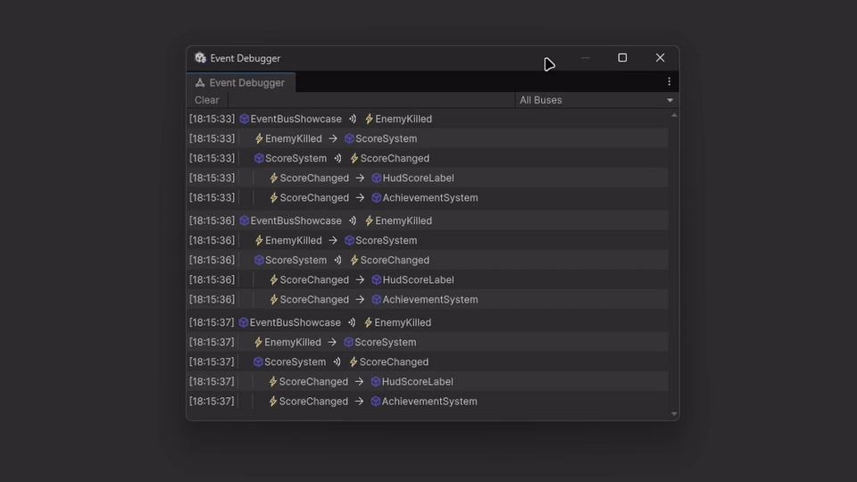

### About EventAggregator

A type-keyed publish/subscribe event bus for Unity that publishes without locks or garbage, from any thread, on every platform.

Producers publish plain structs or classes; listeners implement `IEventListener<T>` and subscribe per event type. The whole API is two interfaces and one class, with no reflection, code generation or dependencies, so it behaves identically under Mono and IL2CPP, with managed code stripping, on desktop, mobile, consoles and WebGL.

It is built for long-running production use: listeners removed mid-publish stop at once, destroyed MonoBehaviours are pruned automatically, a throwing listener never blocks the rest, and teardown order can never crash shutdown code. The Event Debugger window shows every publish and delivery live, as a tree of chain reactions.



### Features

1. Zero-allocation, lock-free publishing
2. Thread-safe and fully re-entrant
3. IL2CPP, stripping and WebGL safe
4. Live Event Debugger window
5. Unsubscribe takes effect mid-publish
6. Destroyed Unity listeners auto-pruned
7. Throwing listeners never block others
8. O(1) subscribe, even in huge bursts
9. Infinite-loop guard in dev builds

Detailed about features - see [FEATURES.md](Documentation/FEATURES.md). How the package is tested - see [TESTING.md](Documentation/TESTING.md).

### Performance

**Publishing allocates nothing and never locks.** In an IL2CPP release build on an Intel Core i7-12700K, a publish costs about 10 ns plus about 3 ns per listener: 13 ns for one listener and 43 ns for ten. The hot path performs a single memory fence regardless of listener count, which keeps it cheap on ARM mobile devices, where IL2CPP's fences are costly.

**Subscribing scales linearly.** 5,000 listeners joining one event in a single frame take about 2 ms and 1 MB under IL2CPP, so spawn waves stay safe even on WebGL, where garbage can only be collected between frames. With the Event Debugger closed or paused, the editor adds a single flag check per publish.

Detailed about performance - see [PERFORMANCE.md](Documentation/PERFORMANCE.md).

### Requirements

1. Unity 2022.3 LTS or newer, including Unity 6.
2. Mono or IL2CPP scripting backend.
3. No package dependencies.

### Limitations

1. Events match their exact type only.
2. Delivery is synchronous, on the publishing thread.
3. Listeners stay referenced until unsubscribed.
4. Listeners must be classes, not structs.
5. The loop guard exists in editor and dev builds only.

### How to install

1. **Git URL.** In Unity, open **Window ▸ Package Manager ▸ + ▸ Add package from git URL…** and enter `https://github.com/reromanlee/EventAggregator.git?path=/UnityPackage#1.0.0`. Drop `#1.0.0` to track the latest `main` instead of a release.
2. **Manifest.** Add the same URL to `Packages/manifest.json`:

   ```json
   {
     "dependencies": {
       "com.reromanlee.eventaggregator": "https://github.com/reromanlee/EventAggregator.git?path=/UnityPackage#1.0.0"
     }
   }
   ```

3. **Tarball.** Download `com.reromanlee.eventaggregator-1.0.0.tgz` from the [latest release](https://github.com/reromanlee/EventAggregator/releases/latest), then choose **+ ▸ Add package from tarball…** in the Package Manager.

The **Getting Started** sample can then be imported from the package's **Samples** tab in the Package Manager.

### How to use

**Create one `EventBus` at your composition root** (a bootstrap MonoBehaviour or your DI container), share it through `IEventBus`, and call `Dispose` on shutdown. Define events as small `readonly struct`s, which flow through the bus without boxing or garbage.

```csharp
using reromanlee.EventAggregator;

public readonly struct ScoreChanged
{
    public readonly int Score;
    public ScoreChanged(int score) => Score = score;
}

eventBus.Publish(new ScoreChanged(42));
```

**Listeners implement `IEventListener<T>` and pair `Subscribe` with `Unsubscribe`**, ideally in `OnEnable` and `OnDisable`, so a disabled object never handles events. A class listening to several event types names each type explicitly, as in `Subscribe<ScoreChanged>(this)`.

```csharp
public sealed class ScoreLabel : MonoBehaviour, IEventListener<ScoreChanged>
{
    private IEventBus eventBus; // injected by your composition root

    private void OnEnable() => eventBus.Subscribe(this);
    private void OnDisable() => eventBus.Unsubscribe(this);

    public void Handle(ScoreChanged eventData) => Debug.Log($"Score: {eventData.Score}");
}
```

**Open Window ▸ Analysis ▸ Event Debugger** to watch events live, and name buses with `bus.SetDebugName("Gameplay")`, which is stripped from player builds. Use `bus.HasListeners<T>()` to skip building expensive events nobody listens to.

Detailed about usage - see [USAGE.md](Documentation/USAGE.md).

### License

Made by Roman Likhadievski (reromanlee.com).

Licensed under MIT - see [LICENSE.md](LICENSE.md).
